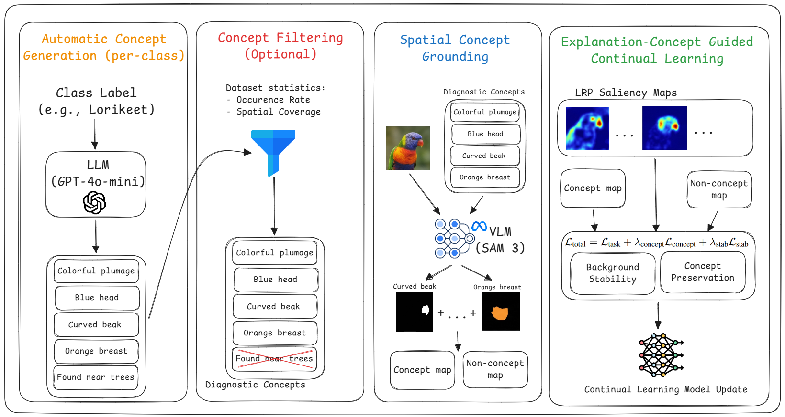
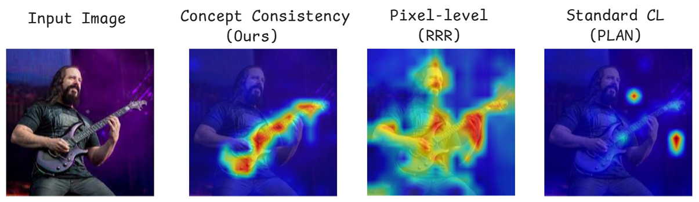
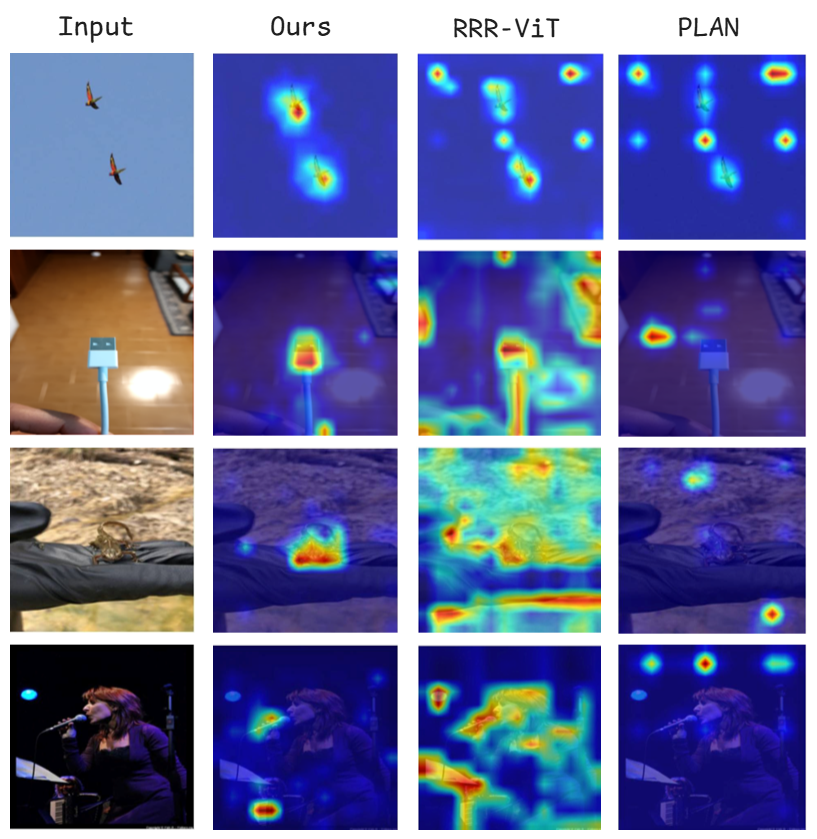

# Semantic Concept Steering Breaks the Explanation Drift Loop in Continual Learning [NeurIPS 2026]

# Official PyTorch Implementation

[](LICENSE)

[](assets/c3l_overview.png)

## Overview

When a model learns a sequence of tasks, it forgets in two ways. Accuracy on old tasks drops, and the *explanations* drift too: attention moves away from the features the model originally relied on. Explanation-aware continual learning methods such as RRR address this by storing the model's own saliency map when a sample enters the replay buffer and penalizing later changes to it. If that stored map already focuses on the background, the method keeps the model focused there. We call this the self-referential drift loop.

C³L (Concept-Consistent Continual Learning) takes its targets from outside the model instead. For each class, an LLM (GPT-4o-mini) proposes visual concepts such as "curved beak" or "red shoulder patches", and SAM 3 localizes them in every replay image. These concept masks do not depend on the learner's state, so they cannot inherit its drift. Training adds two terms to the usual cross-entropy:

```
L_total = L_task + λ_concept · BCE(S_x ⊙ M_concept, M_concept)
                 + λ_stab    · (1 − cos(S_x ⊙ M_bg, S_ref ⊙ M_bg))
```

- **Concept term.** Pushes the relevance map `S_x` (ε-LRP for ResNet-18, AttnLRP for ViT-B/16) into the concept regions `M_concept`.
- **Background stability.** Keeps the *spatial pattern* of background relevance close to the reference map `S_ref` stored at buffer insertion. Because the term is a cosine, it says nothing about magnitude, so background relevance is free to shrink while concept relevance grows (the crowding-out effect described in the paper).

[](assets/c3l_motivation.png)

*Saliency maps for an "electric guitar" image after continual learning. PLAN attends to background artifacts, RRR spreads relevance over the whole scene, and C³L stays on the fretboard and body of the guitar.*

## ⚙️ Installation & Usage

### Setup

```bash
git clone https://github.com/yonisGit/concept_consistent_continual_learning.git
cd concept_consistent_continual_learning
pip install -r requirements.txt
```

You will also need:

- **SAM 3 weights** for Ultralytics (`sam3.pt`, gated on Hugging Face). Put the file in the working directory or point `grounding.sam3_weights` to it.
- **An OpenAI API key**, only for the concept discovery step:
  ```bash
  export OPENAI_API_KEY=...
  ```

### Data

Datasets are read from `data.root` (default `./data`). The expected folder layout for each dataset is listed at the top of `c3l/data/datasets.py`. For readable ImageNet class names (used when prompting the LLM), add `LOC_synset_mapping.txt` to `data.root`.

Datasets without an official split (ImageNet-R, ImageNet-A, ObjectNet) are split 80/20 per class with a fixed seed. ObjectNet has 113 classes that overlap with ImageNet-1K; to get 10 equal tasks, 3 of them are dropped at random, leaving 110.

### Training

A single run (one seed):

```bash
python main.py --config configs/imagenet_r_vit.yaml --set seed=0
```

Any config field can be overridden from the command line, for example:

```bash
python main.py --config configs/cub_resnet18.yaml --set method.lambda_stab=1.0 replay.buffer_size=200 seed=3
```

Results go to `outputs/<experiment_name>/seed_<seed>/`: the resolved config, the training log, and `results.json`, which holds ACC, forgetting, AIA and the full accuracy matrix.

Concept masks are computed once and cached under `grounding.cache_dir`. The default hyperparameters are the ones from the paper:

| Backbone | Explainer | λ_concept | λ_stab |
|---|---|---|---|
| ResNet-18 (ImageNet-1K) | ε-LRP (ε = 1e-6) | 1.0 | 1.5 |
| ViT-B/16 (ImageNet-21K) | AttnLRP | 0.8 | 1.2 |

Other defaults: SGD with lr 0.001 and batch size 128, 20 epochs per task (50 for CUB), a replay buffer of 1,000 samples, and a SAM 3 confidence threshold of 0.3.

### Visualizing explanations

Set `analysis.save_checkpoints=true` during training, then:

```bash
python scripts/visualize_explanations.py --config configs/imagenet_r_vit.yaml \
    --ckpt outputs/.../model_T1.pt outputs/.../model_T10.pt --n 8 --out figs/
```

[](assets/c3l_qualitative.png)


### Datasets

- [CUB-200-2011](https://www.vision.caltech.edu/datasets/cub_200_2011/)
- [DomainNet](https://ai.bu.edu/M3SDA/)
- [ImageNet-R](https://github.com/hendrycks/imagenet-r)
- [ImageNet-A](https://github.com/hendrycks/natural-adv-examples)
- [ObjectNet](https://objectnet.dev/)
- [ImageNet-1K](https://www.image-net.org/download.php) (Split ImageNet-100C and the OOD experiment)
- [Fitzpatrick17k](https://github.com/mattgroh/fitzpatrick17k)
- [PartImageNet](https://github.com/TACJu/PartImageNet)

Each dataset has its own license and terms of use; see `asset_license.json`.

### Credits

This code builds on:

- [Label-free CBM](https://github.com/Trustworthy-ML-Lab/Label-free-CBM) for the concept discovery prompts
- [SAM 3](https://docs.ultralytics.com/models/sam-3/) through the Ultralytics implementation, and Grounding DINO for the Grounded SAM ablation
- AttnLRP (Achtibat et al., ICML 2024) for the transformer relevance rules
- ViT models from [timm](https://github.com/huggingface/pytorch-image-models) and ResNet models from torchvision

Baselines (RRR, EPR, TASS, L2P, CODA-Prompt, MOS, PLAN, and others) were run with their official code releases.

## Citing our work

If you find this work useful, please cite:

```bibtex
@inproceedings{elisha2026semantic,
  title     = {Semantic Concept Steering Breaks the Explanation Drift Loop in Continual Learning},
  author    = {Elisha, Yehonatan and Barkan, Oren and Koenigstein, Noam},
  booktitle = {Advances in Neural Information Processing Systems (NeurIPS)},
  year      = {2026}
}
```
